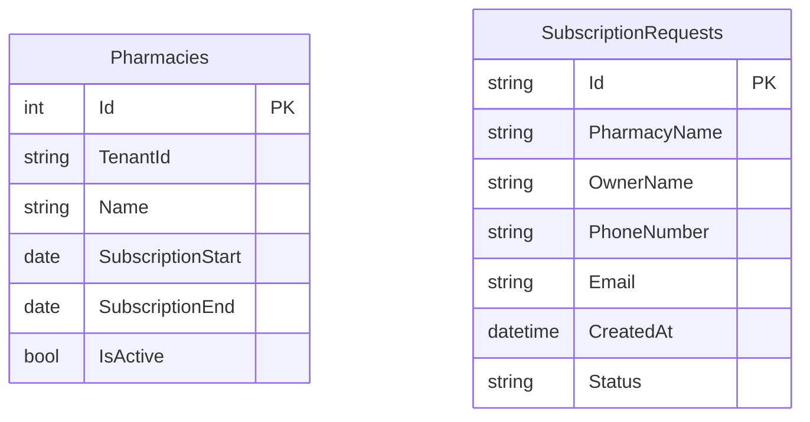
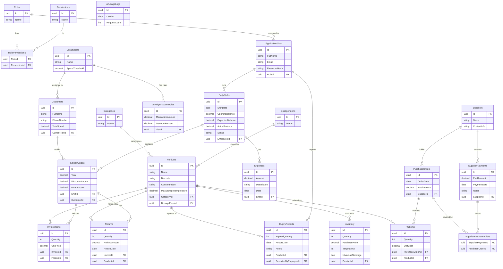

# 💊 PharmaSaaS — Enterprise Pharmacy Management System

A **multi-tenant SaaS backend API** built for pharmacy chains and independent pharmacies. Designed with **Clean Architecture**, **DDD**, and **CQRS**, it provides complete isolation between tenants while delivering a full operational suite — from point-of-sale and inventory to procurement, CRM, and AI-powered prescription parsing.

---

## 📌 Table of Contents

- [System Overview](#system-overview)
- [Multi-Tenant Architecture](#multi-tenant-architecture)
- [Core Features](#core-features)
- [Database Schema](#database-schema)
- [ERD Diagrams](#erd-diagrams)
- [Business Flow](#business-flow)
- [Architecture Decisions](#architecture-decisions)
- [Future Expansion](#future-expansion)

---

## System Overview

PharmaSaaS operates on a **two-database architecture**:

### Shared Database (Platform-level)
Managed by the platform via a protected Admin Key. Controls pharmacy onboarding, subscription tracking, and subscription requests.

```
SubscriptionRequests
Pharmacies
```

Tenant connection strings are **not** stored in the database. They are maintained as configuration data in `AppSettings` and resolved at runtime.

### Per-Pharmacy Database (Tenant-level)
Automatically provisioned when a pharmacy is approved and onboarded. Fully isolated. Contains all operational data.

Every authenticated request carries a `PharmacyId` claim inside the JWT. The system resolves the correct tenant database dynamically using a `TenantDbResolver` before processing any operation.

---

## Multi-Tenant Architecture

### Tenant Configuration

Each tenant's identity and database connection are stored in `AppSettings`, not in the shared database:

```json
"Tenants": [
  {
    "Id": "pharmacy-1",
    "Name": "Pharmacy Name",
    "ConnectionString": "..."
  }
]
```

This keeps infrastructure-level credentials out of application data and simplifies environment-specific configuration.

### Shared Database Administration

Platform management endpoints are protected using a `[SystemOwner]` authorization attribute backed by JWT tokens. Only users with the system owner role can access these operations:

- Pharmacy management
- Subscription management
- Subscription request review

### Tenant Database Authentication

Each tenant database uses its own full authentication stack, completely independent of the shared database:
- **ASP.NET Identity** — user management and password hashing
- **JWT Authentication** — stateless token-based access
- **Roles** — Owner, Manager, Pharmacist, Cashier
- **Permissions** — granular operation-level access control

### Subscription Model

All pharmacies use the same feature set. There are no subscription plans or feature tiers in Version 1. Subscription status is controlled exclusively through three fields on the `Pharmacies` table:

| Field | Purpose |
|---|---|
| `SubscriptionStart` | When the active subscription period began |
| `SubscriptionEnd` | When the current subscription expires |
| `IsActive` | Manual override to enable or disable a pharmacy |

Expired subscriptions block write operations while preserving read access to historical data.

---

## Core Features

### 🔐 Authentication & Access Control
- Employee login with email and password
- Role-based access: Owner, Manager, Pharmacist, Cashier
- Granular permissions per operation
- Password management (change, reset)

### 🏪 Pharmacy Onboarding
- Submit a subscription request (public, IP rate-limited, idempotent)
- Admin reviews and approves, rejects, or marks as contacted
- Approved requests automatically create a new pharmacy tenant record
- Pharmacy management (list, get, update name, toggle active status, set subscription end date)

### 💊 Products & Inventory
- Add and manage products (name, barcode, concentration, dosage form, category)
- Track stock quantity and purchase price per product
- Set target stock levels
- Manually flag a product as out of stock
- View low-stock and shortage reports
- Log expired stock with automatic quantity deduction

### 🛒 Point of Sale
- Open a daily shift with an opening cash balance
- Create sales invoices for customers
- Apply loyalty discounts automatically at checkout
- Log returns per invoice
- Record daily expenses (rent, utilities, etc.)
- Close shift with actual cash count and view discrepancy report

### 📦 Procurement
- Manage suppliers
- Create purchase orders with products, quantities, and unit costs
- Log supplier payments (single or multiple orders per payment)
- Support end-of-month settlement with discount/interest notes

### 👥 Customers & Loyalty
- Create customer profiles with phone number
- Track cumulative spend per customer
- Define loyalty tiers (e.g. Silver at 2,000 EGP)
- Define discount rules per tier (e.g. 2% off invoices above 500 EGP)
- Automatic tier upgrades and discount application

### 📊 Reports
- Daily Sales Report
- Profit Report
- Expense Report
- Shortage Report
- Top Selling Products Report

### 🤖 AI Prescription Parser
- Upload a photo of a handwritten prescription
- Get back a list of detected drug names ready for POS search
- Usage is rate-limited per pharmacy per month

---

## Database Schema

### Shared Database

**Pharmacies:** Id - TenantId - Name - SubscriptionStart - SubscriptionEnd - IsActive

**SubscriptionRequests:** Id - PharmacyName - OwnerName - PhoneNumber - Email - CreatedAt - Status

---

### Tenant Database (Per-Pharmacy)

Tables are ordered by implementation priority.

---

#### 🔐 Identity & Access

**AspNetUsers:** Id - FullName - Email - PasswordHash - PhoneNumber - UserName - NormalizedEmail - NormalizedUserName - SecurityStamp - ConcurrencyStamp - EmailConfirmed - PhoneNumberConfirmed - TwoFactorEnabled - LockoutEnd - LockoutEnabled - AccessFailedCount

**AspNetRoles:** Id - Name - NormalizedName - ConcurrencyStamp

**AspNetUserRoles:** UserId - RoleId

**AspNetUserClaims:** Id - UserId - ClaimType - ClaimValue

**AspNetRoleClaims:** Id - RoleId - ClaimType - ClaimValue

**AspNetUserLogins:** LoginProvider - ProviderKey - ProviderDisplayName - UserId

**AspNetUserTokens:** UserId - LoginProvider - Name - Value

**Permissions:** Id - Name

**RolePermissions:** RoleId - PermissionId

---

#### 💊 Products & Inventory

**Categories:** Id - Name

**DosageForms:** Id - Name

**Products:** Id - Name - Barcode - Concentration - MaxStorageTemperature - CategoryId - DosageFormId

**Inventory:** Id - Quantity - PurchasePrice - TargetStock - IsManualShortage - ProductId

**ExpiryReports:** Id - ExpiredQuantity - ReportDate - Notes - ProductId - ReportedByEmployeeId

---

#### 🛒 Point of Sale

**DailyShifts:** Id - ShiftDate - OpeningBalance - ExpectedBalance - ActualBalance - Status - EmployeeId

**Customers:** Id - FullName - PhoneNumber - TotalSpend - CurrentTierId

**SalesInvoices:** Id - Total - DiscountAmount - FinalAmount - ShiftId - CustomerId

**InvoiceItems:** Id - Quantity - UnitPrice - InvoiceId - ProductId

**Returns:** Id - Quantity - RefundAmount - ReturnDate - InvoiceId - ProductId

**Expenses:** Id - Amount - Description - Date - ShiftId

---

#### 👥 Loyalty

**LoyaltyTiers:** Id - Name - SpendThreshold

**LoyaltyDiscountRules:** Id - MinInvoiceAmount - DiscountPercent - TierId

---

#### 📦 Procurement

**Suppliers:** Id - Name - ContactInfo

**PurchaseOrders:** Id - OrderDate - TotalAmount - SupplierId

**POItems:** Id - Quantity - UnitCost - PurchaseOrderId - ProductId

**SupplierPayments:** Id - PaidAmount - PaymentDate - Notes - SupplierId

**SupplierPaymentOrders:** SupplierPaymentId - PurchaseOrderId

---

#### 🤖 AI

**AIUsageLogs:** Id - UsedAt - RequestCount

---

## ERD Diagrams

### Shared Database



### Per-Pharmacy Database



---

## Business Flow

### 1. Pharmacy Onboarding

1. A prospective customer submits a subscription request with their pharmacy name, owner name, phone number, and email.
2. The request is saved to the shared database with a `Pending` status.
3. An email notification is sent to the platform team.
4. The request is reviewed manually and its status updated to `Contacted`, `Approved`, or `Rejected`.
5. Upon approval, a new `Pharmacy` entity is created in the shared database with a generated `TenantId`, and an email notification is sent with the status update. The tenant's database connection string and configuration are maintained in `AppSettings`.

### 2. Daily Operations

Each working day starts by opening a shift with the cash drawer balance. Throughout the day, invoices are created at the POS — the system checks the customer's loyalty tier, applies any eligible discount, deducts inventory, and updates the customer's total spend. Expenses are logged as they occur. At day-end, the shift is closed with the actual cash count, and the system immediately surfaces any discrepancy.

### 3. Inventory Management

Stock levels are monitored continuously. When a product drops to 50% of its target stock, it appears on the low-stock watch list. At 25%, it is automatically flagged as a shortage. Staff can also manually flag products that are unavailable in the market regardless of quantity. Expired stock is handled through expiry reports which deduct from quantity and create an audit trail.

### 4. Procurement

When stock runs low, a purchase order is created against a supplier with the required products, quantities, and unit costs. Upon delivery, the order is recorded and inventory is updated automatically. Payments to suppliers are logged separately and can cover multiple orders in a single transaction — supporting both immediate payment and end-of-month settlement with notes for any discounts or interest applied.

### 5. Loyalty & Discounts

The pharmacy manager defines tiers (e.g. Silver at 2,000 EGP cumulative spend) and discount rules per tier (e.g. 2% off any invoice above 500 EGP). As customers make purchases, their total spend accumulates and their tier upgrades automatically. Discounts are applied at invoice creation without manual intervention.

### 6. Financial Reporting

The profit report calculates: `Total Sales - Cost of Goods Sold - Total Expenses - Total Shift Discrepancies`. This gives management an accurate view of profitability for any date range. Advanced analytics and cross-pharmacy reporting are planned for future versions.

### 7. AI Prescription Parsing

A staff member photographs a handwritten prescription and submits it to the AI endpoint. The system sends the image to an LLM via OpenRouter and returns a list of detected drug names. Usage is tracked per pharmacy — when the monthly limit is reached, the API responds with a `retryAfter` timestamp instead of a result.

---

## Architecture Decisions

**No ConnectionString in the Shared Database**
Tenant connection strings are treated as infrastructure configuration, not application data. Storing them in `AppSettings` keeps database credentials out of the shared DB and makes environment-specific overrides straightforward.

**SystemOwner JWT for Platform Endpoints**
The shared database management layer uses a `[SystemOwner]` authorization attribute backed by JWT tokens. A dedicated system owner account with a fixed email is seeded during application startup, avoiding the need for a separate identity provider while keeping platform operations secure and auditable.

**Flat Subscription Model**
Version 1 has no multi-plan system. All pharmacies access the same feature set. Subscription validity is determined solely by date range and the `IsActive` flag, avoiding plan migration complexity for the MVP.

**Single-Pharmacy Operation (MVP)**
Each tenant operates as a single logical unit. There are no branches in Version 1. This eliminates cross-branch inventory reconciliation, branch-scoped reporting, and user-branch assignment complexity from the initial scope.

**Request-Based Onboarding**
Pharmacies are not self-served through a registration endpoint. A subscription request initiates a manual review process, giving the platform team control over tenant provisioning during the early growth phase.

---

## Future Expansion

- **Multi-Branch Support** — Branches table, branch-scoped inventory, user-branch assignment, and branch comparison reports. Intentionally excluded from Version 1 to reduce MVP scope.
- **Subscription Plans** — Tiered plans with feature flags, branch limits, and user limits, once the customer base justifies differentiated offerings.
- **Advanced Analytics** — Customer behavior reports, supplier performance reports, and cross-period trend analysis.
- **Self-Service Onboarding** — Automated tenant provisioning triggered by a payment event, removing the manual review step.
