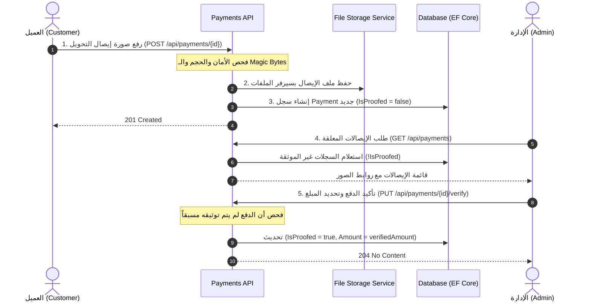

# Payment System Module Specification & Implementation Prompt

> **الغرض من هذا الملف**: 
> هذا الدليل يحتوي على المواصفات الفنية الكاملة وكود التنفيذ الخاص بـ **نظام الدفع (Payment System)** المستخرج من المشروع، مكتوب بصيغة **Prompt تقني دقيق وشامل** يمكنك إرساله لأي AI Agent في مشروع آخر لتطبيقه كما هو دون أي تعقيدات خارجة عن نطاق الدفع.

---

## 🎯 فكرة نظام الدفع (System Architecture Concept)

نظام الدفع المعتمد هنا هو **Manual Payment Proof & Administrative Verification (نظام التحقق اليدوي من إيصالات الدفع)**، وهو مثالي للتحويلات البنكية، والمحافظ الإلكترونية (مثل Vodafone Cash، InstaPay، أو التحويل البنكي المباشر):



---

## 🏗️ مواصفات ومكونات النظام عبر الطبقات (Layer by Layer)

---

### 1. طبقة الـ Domain (الكيانات والقواعد الأساسية)

#### أ. كيان الدفع `Payment`
يحتوي فقط على البيانات الجوهرية لعملية الدفع:
```csharp
namespace Domain.Entities;

public sealed class Payment
{
    public int Id { get; set; }
    
    // مسار صورة الإيصال في السيرفر
    public string? ImageUrl { get; set; }
    
    // هل تم التحقق من الإيصال ومراجعته من الإدارة؟ (false عند الإنشاء)
    public bool IsProofed { get; set; }
    
    // المبلغ الفعلي الذي تم تأكيده بواسطة الإدارة
    public decimal Amount { get; set; }
}
```

#### ب. أخطاء الدفع `PaymentErrors` (Domain Errors)
تعتمد نمط الـ Result/Error pattern لتجنب رمي الـ Exceptions:
```csharp
namespace Domain.Errors;

public record PaymentErrors
{
    public static readonly Error NotFound =
        new("Payment.NotFound", "No payment found", StatusCodes.Status404NotFound);

    public static readonly Error AlreadyExists =
        new("Payment.AlreadyExists", "This order/entity already has a payment", StatusCodes.Status409Conflict);

    public static readonly Error AlreadyVerified =
        new("Payment.AlreadyVerified", "This payment is already verified", StatusCodes.Status409Conflict);

    public static readonly Error NotVerified =
        new("Payment.NotVerified", "Payment must be verified before proceeding", StatusCodes.Status400BadRequest);
}
```

#### ج. إعدادات وقواعد فحص الملفات `FileSettings`
تحديد قيود الأمان لصور الإيصالات:
```csharp
namespace Domain.Settings;

public static class FileSettings
{
    // أقصى حجم للإيصال (2 ميجابايت)
    public const int MaxFileSizeInMB = 2;
    public const int MaxFileSizeInBytes = MaxFileSizeInMB * 1024 * 1024;

    // تواقيع البايتات المحظورة (Magic Bytes) لمنع رفع ملفات تنفيذية خبيثة تم تغيير امتدادها
    public static readonly string[] BlockedSignatures = ["4D-5A", "2F-2A", "D0-CF"]; // 4D-5A = MZ (EXE / DLL)

    // الامتدادات المسموح بها فقط
    public static readonly string[] AllowedImagesExtensions = [".jpg", ".jpeg", ".png"];
}
```

---

### 2. طبقة الـ Application (الـ Contracts و CQRS Handlers)

#### أ. تجريد ملف الإيصال `FileData` (Clean Architecture Abstraction)
من أجل الحفاظ على استقلالية طبقة الـ Application وعدم ربطها بـ `Microsoft.AspNetCore.Http.IFormFile`:
```csharp
namespace Application.Contracts.Files;

public record FileData(
    string FileName,
    string ContentType,
    long Length,
    Stream Stream
) : IDisposable
{
    private bool _disposed = false;

    public void Dispose()
    {
        Dispose(true);
        GC.SuppressFinalize(this);
    }

    private void Dispose(bool disposing)
    {
        if (!_disposed)
        {
            if (disposing)
                Stream?.Dispose();

            _disposed = true;
        }
    }
}
```

#### ب. نماذج البيانات (DTOs & Requests & Responses)
```csharp
namespace Application.Contracts.Payments;

// استجابة تفاصيل الدفع المعلقة للإدارة
public record PaymentResponse(
    int OrderId,
    string CustomerId,
    int PaymentId,
    decimal Amount,
    string? ImageUrl
);

// طلب تأكيد الدفع وتحديد المبلغ من الإدارة
public record PaymentVerifyRequest(
    decimal Amount
);

// فحص صحة طلب التأكيد
public class PaymentVerifyRequestValidator : AbstractValidator<PaymentVerifyRequest>
{
    public PaymentVerifyRequestValidator()
    {
        RuleFor(x => x.Amount)
            .GreaterThan(0)
            .PrecisionScale(10, 2, true);
    }
}
```

---

#### ج. الأوامر والمعالجات (CQRS Commands & Handlers)

##### 1. أمر إضافة إيصال الدفع `AddPaymentCommand`
```csharp
namespace Application.Features.Payments.AddOrderPayment;

public record AddPaymentCommand(int ReferenceId, FileData Image) : IRequest<Result>;

public class AddPaymentCommandHandler(
    IUnitOfWork unitOfWork, 
    IFileStorageService fileStorageService) : IRequestHandler<AddPaymentCommand, Result>
{
    private readonly IUnitOfWork _unitOfWork = unitOfWork;
    private readonly IFileStorageService _fileStorageService = fileStorageService;

    public async Task<Result> Handle(AddPaymentCommand request, CancellationToken cancellationToken = default)
    {
        // 1. توليد اسم ملف مميز وآمن للإيصال
        var fileName = $"payment-{request.ReferenceId}-{Path.GetFileName(request.Image.FileName)}{Path.GetExtension(request.Image.FileName)}";

        // 2. حفظ الملف في التخزين
        await _fileStorageService.SaveAsync(request.Image.Stream, fileName, cancellationToken);
        var relativePath = _fileStorageService.GetRelativePath(fileName);

        // 3. إنشاء كائن الدفع (غير موثق مبدئياً)
        var payment = new Payment
        {
            ImageUrl = relativePath,
            IsProofed = false,
            Amount = 0
        };

        // 4. حفظ الدفع في قاعدة البيانات
        await _unitOfWork.Payments.AddAsync(payment, cancellationToken);
        await _unitOfWork.CompleteAsync(cancellationToken);

        return Result.Success();
    }
}
```

##### 2. أمر تأكيد الدفع بواسطة الإدارة `VerifyPaymentCommand`
```csharp
namespace Application.Features.Payments.VerifyPayment;

public record VerifyPaymentCommand(int PaymentId, decimal Amount) : IRequest<Result>;

public class VerifyPaymentCommandHandler(IUnitOfWork unitOfWork) : IRequestHandler<VerifyPaymentCommand, Result>
{
    private readonly IUnitOfWork _unitOfWork = unitOfWork;

    public async Task<Result> Handle(VerifyPaymentCommand request, CancellationToken cancellationToken = default)
    {
        // 1. البحث عن سجل الدفع
        if (await _unitOfWork.Payments.GetAsync([request.PaymentId], cancellationToken) is not { } payment)
            return Result.Failure(PaymentErrors.NotFound);

        // 2. التحقق من عدم توثيقه مسبقاً لمنع التكرار (Idempotency)
        if (payment.IsProofed)
            return Result.Failure(PaymentErrors.AlreadyVerified);

        // 3. اعتماد الدفع وتحديث المبلغ
        payment.IsProofed = true;
        payment.Amount = request.Amount;

        // 4. حفظ التعديل
        await _unitOfWork.CompleteAsync(cancellationToken);

        return Result.Success();
    }
}
```

##### 3. استعلام الإيصالات غير الموثقة `GetAllNotVerifiedPaymentsQuery`
```csharp
namespace Application.Features.Payments.GetAllNotVerifiedPayments;

public record GetAllNotVerifiedPaymentsQuery() : IRequest<IEnumerable<PaymentResponse>>;

public class GetAllNotVerifiedPaymentsQueryHandler(IUnitOfWork unitOfWork) : IRequestHandler<GetAllNotVerifiedPaymentsQuery, IEnumerable<PaymentResponse>>
{
    private readonly IUnitOfWork _unitOfWork = unitOfWork;

    public async Task<IEnumerable<PaymentResponse>> Handle(GetAllNotVerifiedPaymentsQuery request, CancellationToken cancellationToken = default)
    {
        return await _unitOfWork.Payments
            .FindAllProjectionAsync<PaymentResponse>(
                x => !x.IsProofed,
                cancellationToken: cancellationToken
            );
    }
}
```

---

### 3. طبقة الـ Infrastructure (التخزين وقاعدة البيانات)

#### أ. تهيئة جدول الدفع في EF Core (`PaymentConfiguration`)
```csharp
namespace Infrastructure.Persistence.Configurations;

internal class PaymentConfiguration : IEntityTypeConfiguration<Payment>
{
    public void Configure(EntityTypeBuilder<Payment> builder)
    {
        builder.HasKey(p => p.Id);

        builder
            .Property(p => p.Amount)
            .HasPrecision(10, 2);

        builder
            .Property(p => p.ImageUrl)
            .IsRequired(false);

        builder
            .Property(p => p.IsProofed)
            .HasDefaultValue(false);
    }
}
```

#### ب. خدمة حفظ الملفات `IFileStorageService`
```csharp
namespace Application.Interfaces;

public interface IFileStorageService
{
    Task SaveAsync(Stream stream, string fileName, CancellationToken cancellationToken = default);
    Task RemoveAsync(string relativePath, CancellationToken cancellationToken = default);
    string GetRelativePath(string fileName);
}
```

**التنفيذ الفعلي (Local Storage تحت `wwwroot/images`):**
```csharp
namespace Infrastructure.Services;

public class FileStorageService : IFileStorageService
{
    private readonly string _imagesFolder = "/images";
    private readonly string _imagesPath;
    private readonly string _rootPath;

    public FileStorageService(IWebHostEnvironment webHostEnvironment)
    {
        _rootPath = webHostEnvironment.WebRootPath;
        _imagesPath = Path.Combine(_rootPath, "images");
        
        if (!Directory.Exists(_imagesPath))
            Directory.CreateDirectory(_imagesPath);
    }

    public async Task SaveAsync(Stream stream, string fileName, CancellationToken cancellationToken = default)
    {
        string path = Path.Combine(_imagesPath, fileName);
        using var fileStream = File.Create(path);
        await stream.CopyToAsync(fileStream, cancellationToken);
    }

    public async Task RemoveAsync(string relativePath, CancellationToken cancellationToken = default)
    {
        var path = Path.Combine(_rootPath, relativePath.TrimStart('/'));
        if (File.Exists(path))
            await Task.Run(() => File.Delete(path), cancellationToken);
    }

    public string GetRelativePath(string fileName)
        => Path.Combine(_imagesFolder, fileName).Replace("\\", "/");
}
```

---

### 4. طبقة الـ Presentation (الفحص الأمني والـ Controller)

#### أ. الفلاتر الأمنية لرفع الإيصالات (FluentValidation)

##### 1. فحص الحجم:
```csharp
public class FileSizeValidator : AbstractValidator<IFormFile>
{
    public FileSizeValidator()
    {
        RuleFor(x => x)
            .Must(request => request.Length <= FileSettings.MaxFileSizeInBytes)
            .WithMessage($"File size must not exceed {FileSettings.MaxFileSizeInMB} MB.")
            .When(x => x is not null);
    }
}
```

##### 2. فحص الامتداد:
```csharp
public class ImageExtensionValidator : AbstractValidator<IFormFile>
{
    public ImageExtensionValidator()
    {
        RuleFor(x => x)
            .Must(request =>
            {
                var extension = Path.GetExtension(request.FileName.ToLower());
                return FileSettings.AllowedImagesExtensions.Contains(extension);
            })
            .WithMessage("Image extension is not allowed")
            .When(x => x is not null);
    }
}
```

##### 3. فحص البايتات السحرية (Magic Bytes Security Validation):
```csharp
public class BlockedSignaturesValidator : AbstractValidator<IFormFile>
{
    public BlockedSignaturesValidator()
    {
        RuleFor(x => x)
            .Must(request =>
            {
                using var binary = new BinaryReader(request.OpenReadStream());
                var bytes = binary.ReadBytes(2);
                var fileSequenceHex = BitConverter.ToString(bytes);

                foreach (var signature in FileSettings.BlockedSignatures)
                    if (signature.Equals(fileSequenceHex, StringComparison.OrdinalIgnoreCase))
                        return false; // ملف محظور تم اكتشافه

                return true;
            })
            .WithMessage("Not allowed file content")
            .When(x => x is not null);
    }
}
```

##### 4. كائن الطلب والـ Validator المجمع:
```csharp
namespace Presentation.DTOs.Payments;

public record AddPaymentRequest(IFormFile Image);

public class AddPaymentRequestValidator : AbstractValidator<AddPaymentRequest>
{
    public AddPaymentRequestValidator()
    {
        RuleFor(x => x.Image)
            .NotNull().WithMessage("Image is required")
            .SetValidator(new FileSizeValidator())
            .SetValidator(new BlockedSignaturesValidator())
            .SetValidator(new ImageExtensionValidator());
    }
}
```

#### ب. دالة تحويل الـ `IFormFile` إلى `FileData`
```csharp
public static class FormFileExtensions
{
    public static FileData ToFileData(this IFormFile formFile)
        => new(formFile.FileName, formFile.ContentType, formFile.Length, formFile.OpenReadStream());
}
```

#### ج. الـ Controller (`PaymentsController`)
```csharp
namespace Presentation.Controllers;

[Route("api/[controller]")]
[ApiController]
[Authorize]
public class PaymentsController(ISender sender) : ControllerBase
{
    private readonly ISender _sender = sender;

    /// <summary>
    /// عرض كافة إيصالات الدفع غير الموثقة (مخصص للإدارة)
    /// </summary>
    [HttpGet("")]
    [Authorize(Roles = "Admin")] // أو [HasPermission("payment:verify")]
    [ProducesResponseType(StatusCodes.Status200OK)]
    public async Task<IActionResult> GetAllNotVerified(CancellationToken cancellationToken)
    {
        var result = await _sender.Send(new GetAllNotVerifiedPaymentsQuery(), cancellationToken);
        return Ok(result);
    }

    /// <summary>
    /// رفع إيصال الدفع لعملية معينة
    /// </summary>
    [HttpPost("{referenceId}")]
    [Consumes("multipart/form-data")]
    [ProducesResponseType(StatusCodes.Status201Created)]
    [ProducesResponseType(StatusCodes.Status400BadRequest)]
    public async Task<IActionResult> Add(
        [FromRoute] int referenceId,
        [FromForm] AddPaymentRequest request,
        [FromServices] IValidator<AddPaymentRequest> validator,
        CancellationToken cancellationToken)
    {
        var validationResult = await validator.ValidateAsync(request, cancellationToken);
        if (!validationResult.IsValid)
            return BadRequest(validationResult.ToDictionary());

        using var image = request.Image.ToFileData();

        var result = await _sender.Send(new AddPaymentCommand(referenceId, image), cancellationToken);

        return result.IsSuccess
            ? StatusCode(StatusCodes.Status201Created)
            : Problem(title: result.Error.Code, detail: result.Error.Description, statusCode: result.Error.StatusCode);
    }

    /// <summary>
    /// مراجعة واعتماد إيصال الدفع وتحديد المبلغ المعتمد (مخصص للإدارة)
    /// </summary>
    [HttpPut("{paymentId}/verify")]
    [Authorize(Roles = "Admin")] // أو [HasPermission("payment:verify")]
    [ProducesResponseType(StatusCodes.Status204NoContent)]
    [ProducesResponseType(StatusCodes.Status404NotFound)]
    [ProducesResponseType(StatusCodes.Status409Conflict)]
    public async Task<IActionResult> Verify(
        [FromRoute] int paymentId, 
        [FromBody] PaymentVerifyRequest request, 
        CancellationToken cancellationToken)
    {
        var result = await _sender.Send(new VerifyPaymentCommand(paymentId, request.Amount), cancellationToken);

        return result.IsSuccess
            ? NoContent()
            : Problem(title: result.Error.Code, detail: result.Error.Description, statusCode: result.Error.StatusCode);
    }
}
```

---

## 📋 تعليمات موجهة للـ Agent لتطبيق هذا النظام خطوة بخطوة

إذا أردت من الـ Agent في المشروع الثاني بناء هذا النظام، اطلب منه تنفيذ التالي:

1. **إنشاء كيان الـ `Payment`** في طبقة الـ Domain بالحقول (`Id`, `ImageUrl`, `IsProofed`, `Amount`).
2. **إعداد قيود EF Core** في `PaymentConfiguration` بحيث يكون `Amount` بـ `Precision(10, 2)` و `IsProofed` الافتراضي `false`.
3. **تطبيق خدمة التخزين `IFileStorageService`** لحفظ صور الإيصالات بأمان مع توليد مسار نسبي وتسمية فريدة للملفات.
4. **تطبيق كائن التجريد `FileData`** لفك ارتباط طبقة الـ Application عن تفاصيل الـ HTTP FormFile.
5. **إنشاء الفلاتر الأمنية عبر FluentValidation**:
   - التحقق من حجم الملف (أقل من 2MB).
   - التحقق من امتداد الصورة (`.jpg`, `.jpeg`, `.png`).
   - التحقق الأمني من الـ Header Signatures (Magic Bytes) لمنع رفع ملفات `.exe` متنكرة.
6. **بناء معالجات MediatR**:
   - `AddPaymentCommand`: يستقبل الصورة ويحفظها وينشئ السجل بدون توثيق مبدئي.
   - `VerifyPaymentCommand`: يمنع التكرار (Idempotency) ويحدث حالة التوثيق والمبلغ.
   - `GetAllNotVerifiedPaymentsQuery`: يستعلم عن السجلات التي لم توثق بعد.
7. **إنشاء `PaymentsController`** بالمسارات الثلاثة (`GET` للإدارة، `POST` للرفع، `PUT` للاعتماد).
